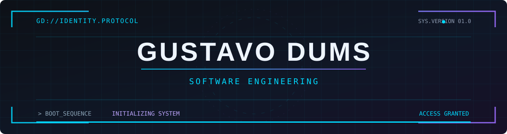

<!-- GUSTAVODUMS // PROFILE INTERFACE -->
<div align="center">
  

  <br />

  

  <br /><br />

  <a href="https://git.io/typing-svg"></a>

  <p>
    
    
    
  </p>
</div>

---

### `01 / ABOUT_ME` — Sobre mim

```yaml
profile:
  name: Gustavo Dums
  role: Estudante de Engenharia de Software
  location: Brasil
  focus: [Java, Backend, Desenvolvimento Web]
  learning: [Engenharia de Software, Testes, Estruturas de Dados]
  interests: [Tecnologia, Games, Carros]
  mindset: "Sempre aprendendo, construindo e evoluindo"
```

Sou estudante de **Engenharia de Software** e desenvolvo projetos que conectam teoria e prática, com foco em **Java, backend e desenvolvimento web**. Também exploro **inteligência artificial e redes neurais em projetos acadêmicos**, além de estrutura de dados e testes de software.

### `02 / TECH_STACK` — Linguagens e tecnologias

<div align="center">
  
</div>

<br />

<div align="center">

| Área | Tecnologias |
|:---|:---|
| **Backend & software** | Java · Spring Boot · Maven · APIs REST · POO |
| **Web** | HTML · CSS · JavaScript · React · Node.js |
| **IA & dados** | Python · TensorFlow · Keras · SQL · MySQL |
| **Qualidade** | JUnit · Testes de Software · Estruturas de Dados |

</div>

### `03 / DEVELOPMENT_TOOLS` — Ferramentas

<div align="center">
  
</div>

---

### `04 / FEATURED_PROJECTS` — Projetos em destaque

<table>
  <tr>
    <td width="50%" valign="top">
      <h3 align="center">🤖 AI Minesweeper</h3>
      <p align="center"><strong>Machine Learning · Python · TensorFlow</strong></p>
      <p>Rede neural aplicada ao Campo Minado, treinada para estimar jogadas seguras a partir do estado do tabuleiro.</p>
      <p align="center"><a href="https://github.com/GustavoDums/ai-minesweeper"></a></p>
    </td>
    <td width="50%" valign="top">
      <h3 align="center">💰 Controle de Despesas</h3>
      <p align="center"><strong>Aplicação · Finanças · Interface</strong></p>
      <p>Projeto de gerenciamento financeiro com cadastro de receitas e despesas, categorias, filtros e relatórios.</p>
      <p align="center"><a href="https://github.com/GustavoDums/App-Gerenciamento-Despesas"></a></p>
    </td>
  </tr>
  <tr>
    <td width="50%" valign="top">
      <h3 align="center">☕ AI Cafeteria Chatbot</h3>
      <p align="center"><strong>Java · Spring Boot · Ollama</strong></p>
      <p>Chatbot acadêmico de cantina com pedidos, sessões de clientes e integração com modelo de linguagem local.</p>
      <p align="center"><a href="https://github.com/GustavoDums?tab=repositories"></a></p>
    </td>
    <td width="50%" valign="top">
      <h3 align="center">♻️ Smart Waste AI</h3>
      <p align="center"><strong>Computer Vision · MobileNetV2</strong></p>
      <p>Projeto acadêmico de visão computacional para reconhecer riscos associados a vidro quebrado em resíduos.</p>
      <p align="center"><a href="https://github.com/GustavoDums?tab=repositories"></a></p>
    </td>
  </tr>
</table>

---

### `05 / CURRENT_OBJECTIVES` — Terminal de objetivos

```bash
$ whoami
> Gustavo Dums | Software Engineering Student

$ cat current_focus.txt
[01] Aprimorar Java e desenvolvimento backend
[02] Evoluir no desenvolvimento web
[03] Aplicar boas práticas e testes de software
[04] Construir e documentar projetos acadêmicos
[05] Aprender novas tecnologias com projetos práticos

$ echo $MISSION
> LEARNING • BUILDING • EVOLVING_
```

### `06 / GITHUB_ANALYTICS` — Métricas

<div align="center">
  
  
  <br />
  
  <br /><br />
  
</div>

### `07 / ACHIEVEMENTS` — GitHub Trophies

<div align="center">
  
</div>

### `08 / CONTRIBUTION_SYSTEM` — Snake Animation

<div align="center">
  <picture>
    <source media="(prefers-color-scheme: dark)" srcset="https://raw.githubusercontent.com/GustavoDums/GustavoDums/output/github-snake-dark.svg" />
    <source media="(prefers-color-scheme: light)" srcset="https://raw.githubusercontent.com/GustavoDums/GustavoDums/output/github-snake.svg" />
    
  </picture>
</div>

> A animação acima será exibida após a primeira execução do workflow em `.github/workflows/snake.yml`.

---

### `09 / CONNECT` — Vamos nos conectar

<div align="center">
  <a href="mailto:gustavogdums@gmail.com"></a>
  <a href="https://github.com/GustavoDums"></a>
</div>

<br />

<div align="center">
  
  <br /><br />
  <sub><code>GUSTAVODUMS // SOFTWARE ENGINEERING // SYSTEM ACTIVE</code></sub>
  <br />
  <sub>Made with ☕ and curiosity · © Gustavo Dums</sub>
</div>
